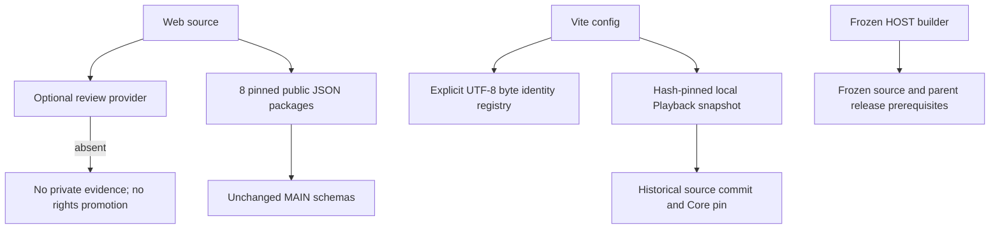

# GOAL39 source snapshot hardening

Parent baseline: `27e72aff9d4602459dc5461bcf46a63622b769ea`.
Scope: isolated source repository only. No original worktree, shared remote, Desktop, R4, Launcher or database is changed. No push is authorized.

## Dependency graph



## Resolved dependencies

- `FanCatalogPage.tsx` no longer statically imports the two private review JSON files. The optional provider seam returns `null` by default, clears previous evidence and reports not-enabled. Provider errors, incomplete payloads and unavailable data fail closed. Existing evidence SHA checks and validators remain in the consumer. No private provider or private payload is shipped.
- Vite and routing/render tests use `verify-playback-snapshot.mjs`. It verifies a SHA-pinned manifest and all five exported Playback files, rejects missing/changed sources, manifest forgery and links. It records the original source commit as provenance, not as the new repository's HEAD. Core and routing adapter bytes are unchanged.
- Eight specific public JSON/schema paths have explicit Git-blob and Windows-checkout byte identities. Only registered identities are accepted, with strict UTF-8 and canonical LF equality. No generic text normalization or binary exemption is applied.
- Restored `scripts/fixtures/goal14-main-admission.json` is the previously pinned STRICT_PUBLIC projection: one match, one source, two stars, no local media assets and an empty rights-review queue. Its bytes, original blob and commit are recorded. This is existing public metadata, not simulated verified match data.

## Reproduction

Use the module's existing lockfile and an approved matching installed dependency set. No dependency download is part of this change.

```text
npm test
npm run build:web:snapshot
python -B scripts/check-main-schemas.py
python -B scripts/audit-baseline.py
```

The guarded snapshot Web build runs TypeScript, the existing 7/18/8 and user-data checks, rights evidence, Collector's Lounge, routing, Vite and render checks. Each child has a timeout and a fresh 2.5 GiB minimum RAM check. It launches no browser or development server.

The original module `npm run build` remains unchanged. Its full legacy gates require private GOAL19 evidence, media assets and other excluded fixtures; it is not reported PASS. The dedicated snapshot build does not replace or weaken those gates.

## Remaining limits

- Public portrait metadata remains, but portrait binaries are not copied. Production media loading and visual fallback require separate acceptance; no image or browser PASS is claimed.
- Historical internal review mode explicitly fails without its original approved private material. The optional interface does not grant a new way to load it.
- HOST configurations remain frozen to their original source identities, hashes and parent Desktop release. No new Desktop build is performed.
- The 61 owner-version differences are archived, not merged by copying other branches. `goal39-analysis.json` classifies included versus excluded paths. Byte equality, TypeScript, public contracts and routing tests address specific interfaces; remaining semantic integration is not automatically certified.
- Professional secret scanners are not installed. The local audit is a pattern and file-boundary check, not complete secret or privacy certification. Installed dependency binaries, generated outputs and local audit details stay ignored/outside Git.
- Original `provenance/files.json`, `excluded.json`, `validation.json` and `blockers.json` describe GOAL38, and are retained as historical records. `goal39-changes.json` and `goal39-validation.json` describe this follow-up.

## Push and rollback

This remains a local review candidate. A future push needs separate approval for an exact commit and new branch; no reviewed branch may be overwritten. Preserve the initial commit and follow-up commit. Rollback means using the original worktrees or reviewing the parent in a separate directory; do not reset, clean or rewrite any original repository.

Final validation note: an earlier complete guarded Web build passed. After adding the explicit report-text pin to the existing report check, the final expanded run passed TypeScript, 7/18/8, report, rights and Collector checks, then stopped before routing at the unchanged RAM guard. It was not retried. Latest regression tests passed; final expanded Vite remains NOT_TESTED. No current full-build PASS is inferred from the earlier receipt.
